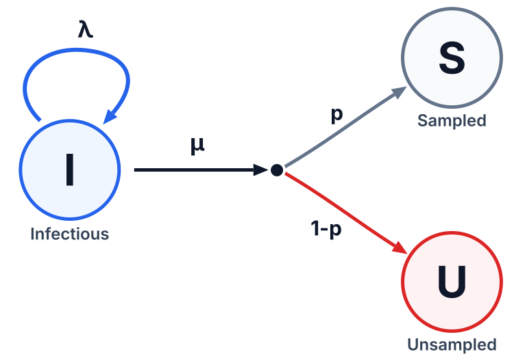
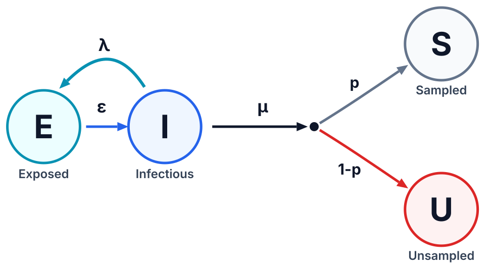
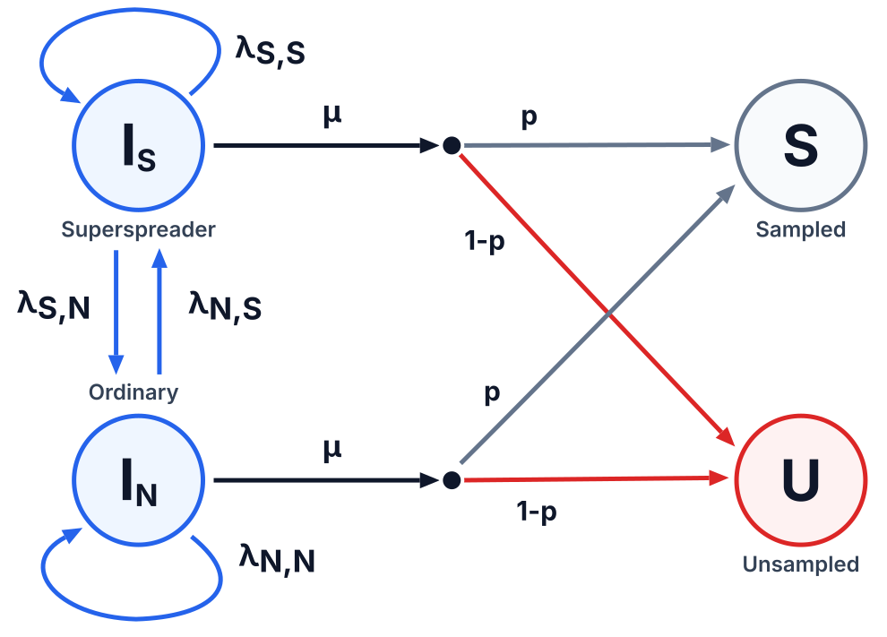
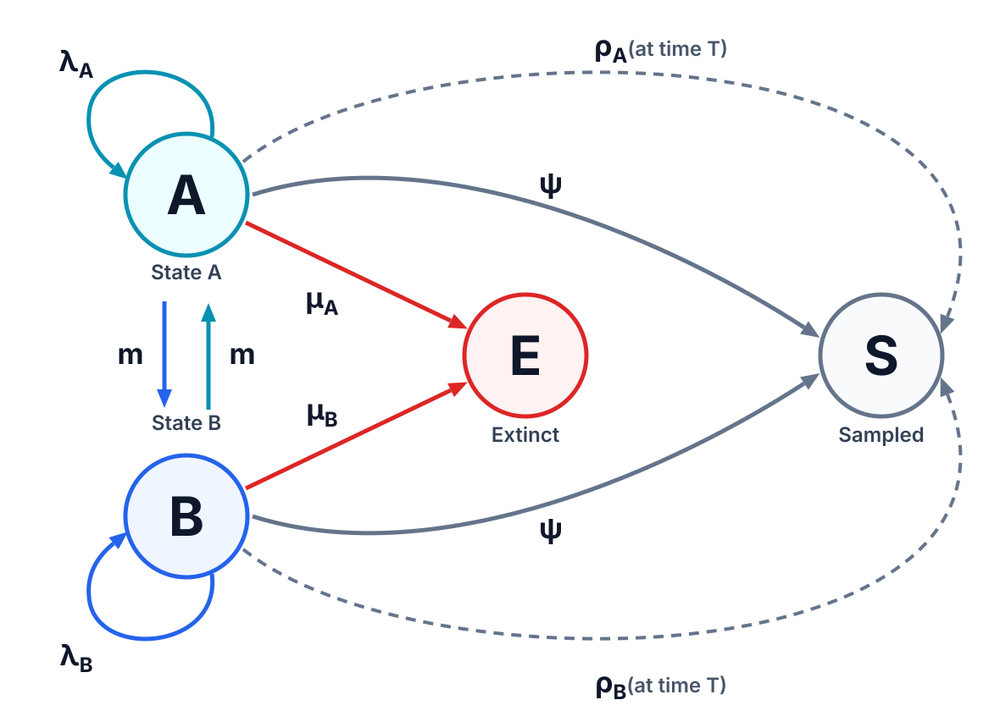
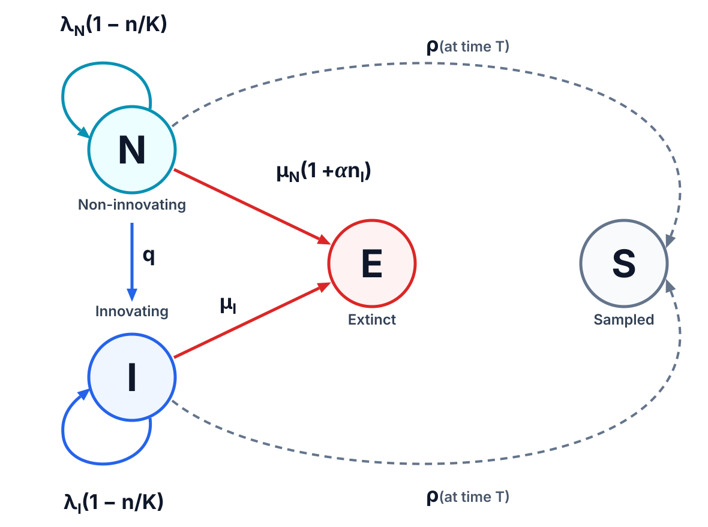
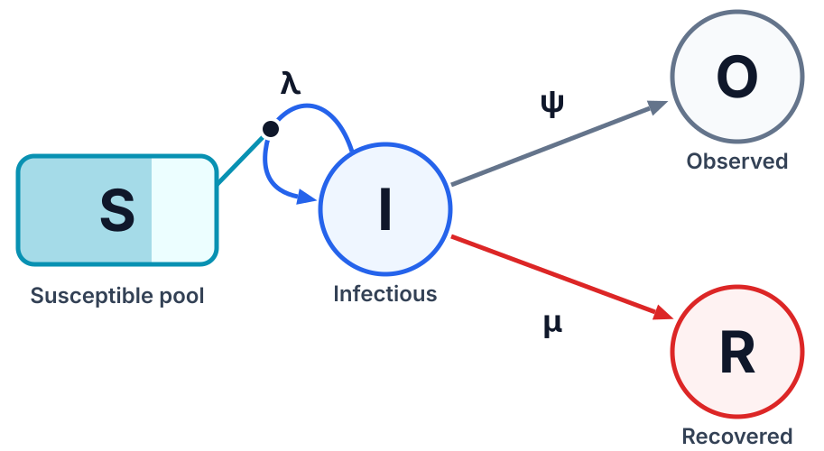
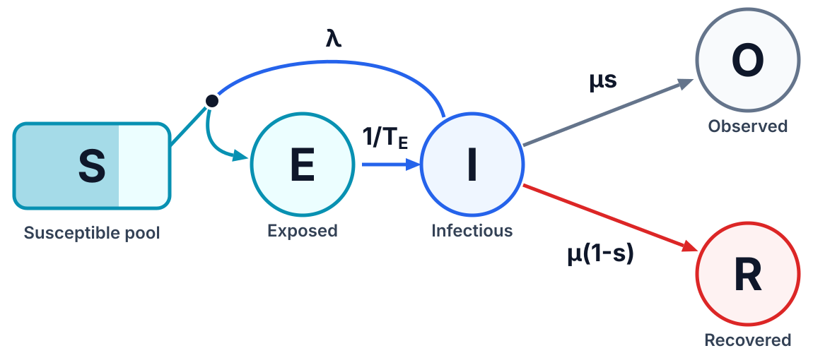
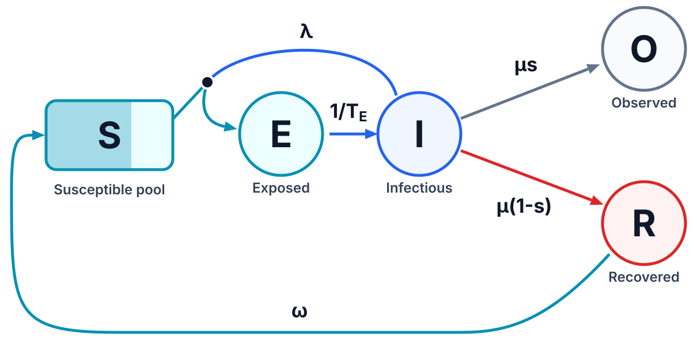

# 💡 Examples

These examples simulate classic models from macroevolution, phylodynamics, and population genetics. None of them needs new code: every model is assembled from built-in event rules and hazards. Processes that the built-in models cannot express, such as non-Markovian dynamics with per-lineage memory, can be added as plugins, without modifying Phyloom itself (see the [Plugins](https://github.com/gabriele-marino/phyloom/tree/main/plugins) for details).

Each example is available in two equivalent forms, which produce the same dataset for the same seed:

- a **YAML configuration** in [`examples/yaml/`](https://github.com/gabriele-marino/phyloom/tree/main/examples/yaml), which the `phyloom` command runs directly, with no Python code needed.
- a **Python script** in [`examples/python/`](https://github.com/gabriele-marino/phyloom/tree/main/examples/python), which builds the same model with the Python API. Read it to see what happens underneath, or start from it to customize the pipeline in Python.

For complete references, see the [YAML user guide](https://gabriele-marino.github.io/phyloom/user_guide/yaml.html) and the [Python user guide](https://gabriele-marino.github.io/phyloom/user_guide/python.html).

| Model | Examples |
| --- | --- |
| [Birth-death-sampling-hybridization](#-birth-death-sampling-hybridization-models) | [BD](#bd-constant-rates-with-a-sampling-intervention), [BDEI](#bdei-an-exposed-non-infectious-stage), [BDSS](#bdss-superspreading-lineages), [BiSSE](#bisse-a-binary-trait-driving-speciation-and-extinction), [BDSH](#bdsh-three-kinds-of-hybridization), [SeasonalBD](#seasonalbd-a-seasonal-transmission-rate), [DiversityDependent](#diversitydependent-diversity-dependence-and-competitive-replacement), [BDAliSim](#bdalisim-alignments-along-birth-death-trees) |
| [The coalescent](#-the-coalescent) | [Coalescent](#coalescent-a-single-population-of-constant-size), [SerialCoalescent](#serialcoalescent-serially-sampled-tips), [StructuredCoalescent](#structuredcoalescent-two-demes-connected-by-migration), [ExponentialGrowthCoalescent](#exponentialgrowthcoalescent-an-exponentially-growing-population) |
| [Compartmental epidemics](#-compartmental-epidemics) | [SIR](#sir-susceptible-infectious-recovered), [SEIR](#seir-an-incubation-stage), [SEIRS](#seirs-waning-immunity) |

## 🚀 Running an example

To run an example, you need [Python](https://www.python.org/downloads/) 3.10 or later. In the commands below, replace `<example>` with the name of the example's files (for example, `BD`, `SIR`, or `Coalescent`).

1. Create and activate a virtual environment, then install Phyloom from PyPI. This also installs the `phyloom` command:

   ```bash
   python -m venv .venv
   source .venv/bin/activate       # on Windows: .venv\Scripts\activate
   pip install phyloom
   ```

2. Clone the repository and move into it:

   ```bash
   git clone https://github.com/gabriele-marino/phyloom.git
   cd phyloom
   ```

3. Run either form of the example:

   ```bash
   phyloom examples/yaml/<example>.yaml       # YAML configuration
   python examples/python/<example>.py        # equivalent Python script
   ```

4. Find the dataset in `outputs/<example>-yaml` for the YAML file and `outputs/<example>-python` for the script, with one folder per split.

   ```text
   outputs/<example>-<yaml|python>/
   ├── train/
   │   ├── data/<sample-id>/...   # files written by the output hooks
   │   └── metadata.csv           # drawn parameter values, rejections, run time, and logs
   └── ...
   ```

Splits that already exist are skipped, so delete the output folder (or change `output_dir` in the YAML file, `OUTPUT_DIR` in the script) to regenerate a dataset.

## 🔍 Reading an example

Every YAML file has the same five sections, and the matching script follows the same order, turning each section into constants or functions with the same names in every script:

| Section | YAML file | Python script |
| --- | --- | --- |
| **Dataset settings**: where the dataset is written, how many samples each split has, parallelism, and the master seed | `output_dir`, `n_samples`, `n_jobs`, `seed` | The constants `OUTPUT_DIR`, `N_SAMPLES`, `N_JOBS`, `SEED` |
| **Context**: the priors of the parameters, from which sample-specific values are drawn anew for every sample and saved in `metadata.csv` | `context` | A frozen `Context` dataclass, and `draw_context`, which makes the same random draws in the same order |
| **Model**: the model family, its initial condition, its events, and its scheduled actions | `model` | `build_model`, which returns a fresh simulator object for each trial |
| **Trials**: when a trial ends and whether it is kept | `stop_criterion`, `max_time`, `acceptance_criterion`, `max_rejections` | `should_stop` and `is_accepted` |
| **Outputs**: extra `metadata.csv` columns and the files written for each sample | `logs`, `output_hooks`, `post_commands` | `logs` and `write_outputs` |

In each Python script, `simulate` then runs the trials of one sample, and `main` generates the splits.

## 🌱 Birth-death-sampling-hybridization models

The birth-death-sampling-hybridization (`bdsh`) model simulates a population of lineages forward in time, from a single ancestor in a given initial state. Every lineage carries a discrete state label, such as a stage of infection, a host type, a location, or a trait. Four event rules act on a single lineage drawn at random, and can be restricted to lineages in a given state: `birth` replaces a lineage by two descendants, each keeping the parent's state or taking a new one; `death` ends a lineage without observing it; `sampling` records a lineage as an observed tip, and either ends it (sampling with removal) or lets it continue (sampling without removal); and `migration` moves a lineage to another state. The three hybridization rules, `ldh`, `lnh`, and `lgh`, act on a pair of lineages drawn at random, at a rate per eligible pair, and join the two parents into a hybrid lineage, differing in whether neither, one, or both parents persist. Scheduled actions change the population at fixed times instead, for instance through `rho_sample`, which samples each current lineage with a fixed probability, as in sampling at the present. The resulting history is a tree, or a network once hybridizations occur.

### BD: constant rates with a sampling intervention



The constant-rate birth-death model with sampling through time (Stadler, 2010), the simplest phylodynamic model of an epidemic. Infectious lineages (state `I`) transmit, i.e. branch, at rate $\lambda$ and are removed (by recovery, death, or isolation) at rate $\mu$; each removal is sampled with probability $p$. Rather than drawing $\lambda$ directly, the context draws the basic reproduction number $R_0 = \lambda/\mu$, the expected number of secondary infections caused by one infected individual (Stadler et al., 2012), and the mean infectious period $1/\mu$, and derives $\lambda = R_0\mu$. Removal at total rate $\mu$ is written as two competing events, unsampled death at rate $\mu(1-p)$ and sampling at rate $\mu p$. Sampling effort rises at a random intervention time, as when testing is scaled up during an outbreak: $p$ goes from `p_before` to `p_after`, at least twice as large, and both removal rates are `skyline` hazards (Stadler et al., 2013) that switch at `intervention_time` and always sum to $\mu$, so the intervention changes which removals are observed, not the epidemic dynamics. Each trial stops when `n_leaves` tips have been sampled, and is kept only if the epidemic is still ongoing and at least one tip was sampled before the intervention, so that the tree informs `p_before`. Each sample stores the full history (`history.nwk`) and the sampled tree (`sampled.nwk`); `metadata.csv` also records the number of tips sampled before the intervention.

**Files:**
[`examples/yaml/BD.yaml`](https://github.com/gabriele-marino/phyloom/blob/main/examples/yaml/BD.yaml),
[`examples/python/BD.py`](https://github.com/gabriele-marino/phyloom/blob/main/examples/python/BD.py)

### BDEI: an exposed, non-infectious stage



The birth-death exposed-infectious (BDEI) model (Stadler et al., 2014) adds an incubation period to BD, as for pathogens such as Ebola or SARS-CoV-2, where infected individuals are not infectious straight away. Newly infected lineages start exposed (state `E`): they neither transmit nor are removed, and become infectious (state `I`) at rate $\varepsilon$. Infectious lineages transmit at rate $\lambda$, each transmission creating a new `E` lineage beside the parent, and are removed at rate $\mu$, each removal sampled with probability $p$. The `child_states` of the `birth` rule and the `migration` rule from `E` to `I` are the whole of the difference from BD. This makes BDEI a multi-type birth-death model, in which every rate may depend on the state of the lineage (Stadler and Bonhoeffer, 2013; Kühnert et al., 2016).

The context draws the rates through interpretable quantities: $R_0$, the total duration of infection $T = 1/\varepsilon + 1/\mu$, and the fraction $f$ of it spent incubating, so that the incubation period is $T_E = fT$, the infectious period is $T_I = (1-f)T$, and $\lambda = R_0/T_I$. The epidemic starts from an exposed individual with probability 0.8. Each trial stops when `n_leaves` tips have been sampled, and is kept only if the epidemic is still ongoing. Each sample stores the sampled tree (`sampled.nwk`); `metadata.csv` also records how many lineages are still incubating or infectious when the trial stops, i.e. the unobserved epidemic behind the tree.

**Files:**
[`examples/yaml/BDEI.yaml`](https://github.com/gabriele-marino/phyloom/blob/main/examples/yaml/BDEI.yaml),
[`examples/python/BDEI.py`](https://github.com/gabriele-marino/phyloom/blob/main/examples/python/BDEI.py)

### BDSS: superspreading lineages



The birth-death superspreading (BDSS) model (Stadler and Bonhoeffer, 2013) captures heterogeneity in transmission, where a minority of individuals cause a majority of infections. Infectious lineages are either ordinary (`I_N`) or superspreaders (`I_S`), and each class can transmit to either class, giving four birth rates $\lambda_{NN}$, $\lambda_{NS}$, $\lambda_{SN}$, and $\lambda_{SS}$ (parent class first, offspring class second). Both classes are removed at the same rate $\mu = 1/T_I$, with $T_I = 2.5$, and sampled with probability $p = 0.25$.

The context derives those four rates from three interpretable quantities: the average reproduction number $R_0$; the superspreading fraction $f_{SS}$, the probability that a new infection is a superspreader, whatever the class of its infector; and the transmission ratio $r_{SS}$, the factor by which superspreaders transmit more than ordinary spreaders. Writing $R_{XY} = \lambda_{XY}/\mu$, the expressions in the context solve $R_{NS}/(R_{NN}+R_{NS}) = R_{SS}/(R_{SN}+R_{SS}) = f_{SS}$, $R_{SN}+R_{SS} = r_{SS}(R_{NN}+R_{NS})$, and $(1-f_{SS})(R_{NN}+R_{NS}) + f_{SS}(R_{SN}+R_{SS}) = R_0$. This kind of reparameterization keeps priors on quantities one can reason about. The first lineage is a superspreader with probability $f_{SS}$. Each trial stops when `n_leaves` tips have been sampled, and is kept only if the epidemic is still ongoing. Each sample stores the sampled tree (`sampled.nwk`); `metadata.csv` also records the frequency of superspreaders among the lineages still infectious at the end of the trial, which approaches $f_{SS}$ in large outbreaks.

**Files:**
[`examples/yaml/BDSS.yaml`](https://github.com/gabriele-marino/phyloom/blob/main/examples/yaml/BDSS.yaml),
[`examples/python/BDSS.py`](https://github.com/gabriele-marino/phyloom/blob/main/examples/python/BDSS.py)

### BiSSE: a binary trait driving speciation and extinction



The binary-state speciation and extinction (BiSSE) model (Maddison et al., 2007) asks whether a trait, such as a morphological character or a mode of reproduction, affects the rates at which species diversify. A binary trait, `A` or `B`, sets each lineage's speciation ($\lambda_A$, $\lambda_B$) and extinction ($\mu_A$, $\mu_B$) rates, and lineages switch trait at rate $m$ in either direction. The priors make `B` speciate up to twice as fast as `A`, and keep extinction between a fifth and a half of speciation in both states. The clade is observed in two ways, as in the fossilized birth-death process (Heath et al., 2014; Gavryushkina et al., 2014): fossil-like sampling at rate $\psi$ during the simulation, with `removal: false` so the lineage survives being sampled and can appear as a sampled ancestor, and a scheduled action at the present (`max_time`) that samples a fraction $\rho_A$ or $\rho_B$ of the surviving lineages of each state. There is no `stop_criterion`, so every trial runs to `max_time` unless the clade dies out first, and trees vary in size. A trial is kept only if more than ten tips of each state were sampled. If the parameters of a sample make this too unlikely, `max_rejections` replaces them with a new draw after ten rejected trials, instead of retrying forever. Each sample stores the sampled tree (`sampled.nwk`), with both fossil-like and present-day samples, whose node labels carry the trait through the tree.

**Files:**
[`examples/yaml/BiSSE.yaml`](https://github.com/gabriele-marino/phyloom/blob/main/examples/yaml/BiSSE.yaml),
[`examples/python/BiSSE.py`](https://github.com/gabriele-marino/phyloom/blob/main/examples/python/BiSSE.py)

### BDSH: three kinds of hybridization

This example generates phylogenetic networks under a birth-death process with hybridization (Zhang et al., 2018; Justison et al., 2023). Hybridization rules act on a pair of lineages and join them into a hybrid lineage with two parents, so the history is a network rather than a tree. Lineages branch at rate $\lambda$ and are sampled at rate $\psi$ without being removed, while pairs of lineages hybridize through three competing events (Justison and Heath, 2024): lineage-degenerative hybridization (`ldh`), in which the two parents merge into a single hybrid child, so the number of lineages decreases by one; lineage-neutral hybridization (`lnh`), in which one parent persists while the other is absorbed into the hybrid child, so the number of lineages is unchanged; and lineage-generative hybridization (`lgh`), in which both parents persist and the hybrid is a new lineage, so the number of lineages increases by one. Each kind of hybrid gets its own state, so the output records which kind of event produced each reticulation. Hybridization rules act on lineage *pairs* rather than lineages, so their total rate grows quadratically with the size of the clade. Each rate is drawn independently for every sample, so the dataset covers networks dominated by one kind of hybridization as well as mixtures.

Each trial stops when `n_leaves` tips have been sampled. A trial is accepted only if the sampled network really contains a reticulation, that is, if it has more edges than a tree on the same nodes would (a tree has one edge fewer than nodes). A hybridization disappears from the sampled network when one of its parents has no other sampled descendants. Each sample stores the full history (`history.nwk`) and the sampled network (`sampled.nwk`), in extended Newick; `metadata.csv` also records the number of tips and reticulations visible in the sampled network.

**Files:**
[`examples/yaml/BDSH.yaml`](https://github.com/gabriele-marino/phyloom/blob/main/examples/yaml/BDSH.yaml),
[`examples/python/BDSH.py`](https://github.com/gabriele-marino/phyloom/blob/main/examples/python/BDSH.py)

### SeasonalBD: a seasonal transmission rate

Many infections, such as influenza, are transmitted more efficiently in some seasons than in others. This is a birth-death process whose transmission rate is a function of time (Kendall, 1948), here a seasonal cycle,

$$
\lambda(t) = \lambda_0\left(1 + a\cos\left(\frac{2\pi(t - t_p)}{P}\right)\right),
$$

with mean $\lambda_0 = R_0\mu$, amplitude $a$, period $P$ (one time unit, e.g. a year), and peak at $t_p$. Lineages are removed at a constant rate $\mu$ and each removal is sampled with probability $p$, so only transmission is seasonal.

The built-in hazards are constant, piecewise constant (`skyline`), exponential, or a point mass (`delta`), and none of them covers this rate. It is therefore given as a plain expression of the simulated time `t` through the `numeric` hazard, which integrates it by quadrature and inverts the cumulative hazard numerically; firing times are exact up to the tolerance of the solver, with no discretization of time. `initial_dt` is where the root solver starts bracketing a firing time, and setting it to a typical waiting time, here $1/\lambda_0$, keeps that search short. Each trial stops when `n_leaves` tips have been sampled, and is kept only if the epidemic is still ongoing. Each sample stores the full history (`history.nwk`) and the sampled tree (`sampled.nwk`); `metadata.csv` also records how many tips were sampled while transmission was above its mean, that is, within a quarter period of a seasonal peak.

**Files:**
[`examples/yaml/SeasonalBD.yaml`](https://github.com/gabriele-marino/phyloom/blob/main/examples/yaml/SeasonalBD.yaml),
[`examples/python/SeasonalBD.py`](https://github.com/gabriele-marino/phyloom/blob/main/examples/python/SeasonalBD.py)

### DiversityDependent: diversity dependence and competitive replacement



In diversity-dependent models (Rabosky and Lovette, 2008; Etienne et al., 2012), speciation slows as a clade fills its ecological niches, so diversity saturates. This example combines diversity dependence with competitive replacement. A clade of non-innovating lineages (state `N`) diversifies until it approaches a carrying capacity $K$. `N` lineages acquire a key innovation at rate $q$ and become innovating lineages (state `I`), which speciate $r_I$ times faster. With $n$ extant lineages, of which $n_I$ are innovators, the speciation rate of each state is multiplied by $\max(0, 1 - n/K)$, so speciation stops at $K$ lineages, and the extinction rate of `N` lineages by $1 + \alpha n_I$, so innovators progressively replace incumbents, with $\alpha$ setting the strength of competition. Hazards depend only on time, so both multipliers are `rate_multiplier` expressions of the live model, evaluated again before every step so that the rates follow the state as it changes. There is no `stop_criterion`, so every trial runs to `max_time` unless the clade dies out first. At the present, a scheduled action samples a fraction $\rho$ of the surviving lineages, and a trial is kept only if at least 20 tips, 5 of them innovators, were sampled. Each sample stores the full history (`history.nwk`), which also shows the extinct incumbents, and the sampled tree (`sampled.nwk`); `metadata.csv` also records the number of extant lineages of each state at the present, which shows how far the replacement has progressed.

**Files:**
[`examples/yaml/DiversityDependent.yaml`](https://github.com/gabriele-marino/phyloom/blob/main/examples/yaml/DiversityDependent.yaml),
[`examples/python/DiversityDependent.py`](https://github.com/gabriele-marino/phyloom/blob/main/examples/python/DiversityDependent.py)

### BDAliSim: alignments along birth-death trees

This example requires [IQ-TREE 3](https://iqtree.github.io/) (Wong et al., 2026), which provides AliSim (Ly-Trong et al., 2022), installed with its `iqtree3` command on your `PATH`. It simulates sampled trees under the constant-rate birth-death model with sampling through time (Stadler, 2010), with the context drawing $R_0$, the removal rate $\mu$, and the sampling probability $p$. Each trial stops when `n_leaves` tips have been sampled, and is kept only if the epidemic is still ongoing. A post command, run last for each sample, then passes the sampled tree to AliSim, which simulates a DNA alignment along it under the Jukes-Cantor model (Jukes and Cantor, 1969). Branch lengths, in units of time, are converted into substitutions per site by `--branch-scale`, with a strict clock rate drawn for every sample, and the length of the alignment is drawn uniformly between 500 and 1000 sites. Each sample stores the sampled tree (`sampled.nwk`), the simulated alignment in FASTA format (`alignment.fa`), and the AliSim log (`sampled.nwk.log`).

**Files:**
[`examples/yaml/BDAliSim.yaml`](https://github.com/gabriele-marino/phyloom/blob/main/examples/yaml/BDAliSim.yaml),
[`examples/python/BDAliSim.py`](https://github.com/gabriele-marino/phyloom/blob/main/examples/python/BDAliSim.py)

## 🔗 The coalescent

Coalescent models describe the genealogy of a sample backward in time, from the sampled lineages to their most recent common ancestor (Kingman, 1982), without simulating the rest of the population. The `coalescent` model starts from an initial set of sampled lineages per state, such as demes, and has two event rules, both of which can be restricted to lineages in given states: `coalesce` merges a pair of lineages into their common ancestor, at a rate per eligible pair that is inversely proportional to the effective population size, so that changes in population size are expressed through a time-varying rate; and `retrace` moves a single lineage to another state, as a migration traced backward in time. Samples taken further in the past are added by scheduled actions that call `spawn`, which adds a new sampled lineage at the scheduled time, giving serially sampled tips.

### Coalescent: a single population of constant size

The Kingman coalescent (Kingman, 1982) describes the genealogy of a sample of lineages drawn from a large, well-mixed population of constant effective size $N_e$, and is simulated backward in time, from the samples to their most recent common ancestor. Between 8 and 12 lineages are sampled at the present. Each pair of lineages merges at rate $1/(2N_e)$, with time measured in generations, and counting every pair supplies the $\binom{n}{2}$ factor of the Kingman coalescent, so the total coalescence rate falls from $\binom{n}{2}/(2N_e)$ as lineages merge. The simulation stops when a single lineage, the root, is left. Each sample stores the genealogy (`genealogy.nwk`).

**Files:**
[`examples/yaml/Coalescent.yaml`](https://github.com/gabriele-marino/phyloom/blob/main/examples/yaml/Coalescent.yaml),
[`examples/python/Coalescent.py`](https://github.com/gabriele-marino/phyloom/blob/main/examples/python/Coalescent.py)

### SerialCoalescent: serially sampled tips

In many datasets, samples are not all collected at the same time: ancient DNA, or pathogens sequenced throughout an epidemic, give serially sampled, or heterochronous, tips (Drummond et al., 2002). Backward in time, such a sample enters the genealogy at its sampling time, and from then on can only coalesce with lineages that are still being traced. Here, between 4 and 8 lineages are sampled at the present, and between 4 and 8 further lineages at times drawn uniformly between the present and $2N_e$ generations in the past, within the expected depth of the genealogy. Each of them is added at its sampling time by a scheduled action that calls `spawn`. The genealogy may coalesce into a single lineage before all samples are added, so the stop criterion also requires the oldest sample to have been added; until then, the single remaining lineage is simply traced further back. Each sample stores the genealogy (`genealogy.nwk`), whose tips lie at their sampling times; `metadata.csv` also records the time to the most recent common ancestor.

**Files:**
[`examples/yaml/SerialCoalescent.yaml`](https://github.com/gabriele-marino/phyloom/blob/main/examples/yaml/SerialCoalescent.yaml),
[`examples/python/SerialCoalescent.py`](https://github.com/gabriele-marino/phyloom/blob/main/examples/python/SerialCoalescent.py)

### StructuredCoalescent: two demes connected by migration

The structured coalescent (Takahata, 1988; Notohara, 1990) extends the coalescent to a population subdivided into demes, such as geographic locations or host species, between which individuals migrate. Four lineages are sampled from each of two demes, `A` and `B`, of the same effective size, connected by symmetric migration. Backward in time, lineages coalesce only within their deme, at the same pairwise rate as in a single population, and `retrace` rules move them between demes at a constant rate, so two lineages in different demes must come to share a deme before they can merge. As time runs backward, a `retrace` from `A` to `B` means that the ancestor belonged to deme `B`: forward in time, a migration from `B` into `A`. The stop criterion is essential here, since `retrace` events would otherwise keep firing on the root forever. Each sample stores the genealogy (`genealogy.nwk`), in which each `retrace` is kept as a node with one child, and node labels carry the deme, recording the deme of each ancestral lineage over time.

**Files:**
[`examples/yaml/StructuredCoalescent.yaml`](https://github.com/gabriele-marino/phyloom/blob/main/examples/yaml/StructuredCoalescent.yaml),
[`examples/python/StructuredCoalescent.py`](https://github.com/gabriele-marino/phyloom/blob/main/examples/python/StructuredCoalescent.py)

### ExponentialGrowthCoalescent: an exponentially growing population

A coalescent with a time-varying effective population size (Griffiths and Tavaré, 1994; Slatkin and Hudson, 1991), here for a population, such as an expanding epidemic, that has grown exponentially at rate $g$ up to the present size $N_e(0)$. Backward in time, the effective size $N_e(t) = N_e(0)\,e^{-gt}$ shrinks and the pairwise coalescence rate $1/(2N_e(t))$ grows as $e^{gt}$. That is an `exponential` hazard with a negative `decay`. Because coalescence is rare near the present and fast in the small ancestral population, the genealogies are star-like, with long terminal branches and ancestors compressed near the root. The simulation stops when a single lineage, the root, is left. Each sample stores the genealogy (`genealogy.nwk`).

**Files:**
[`examples/yaml/ExponentialGrowthCoalescent.yaml`](https://github.com/gabriele-marino/phyloom/blob/main/examples/yaml/ExponentialGrowthCoalescent.yaml),
[`examples/python/ExponentialGrowthCoalescent.py`](https://github.com/gabriele-marino/phyloom/blob/main/examples/python/ExponentialGrowthCoalescent.py)

## 🦠 Compartmental epidemics

Compartmental models describe an epidemic in a finite host population (Kermack and McKendrick, 1927; Hethcote, 2000), so that transmission slows down as susceptible hosts are depleted. The `epidemic` model keeps uninfected compartments, such as susceptible and recovered hosts, as pools of plain counts, and infected hosts as lineages, so that only the transmission tree is recorded in full. Its event rules act on lineages, on hosts in a pool, or on both: `infection` takes a host from a pool, e.g. susceptible, and adds a new lineage beside its infector, at a rate per pair of an infected lineage and a host in that pool, so that transmission slows as the pool empties; `recovery` ends a lineage, optionally sampling it, and returns the host to a pool, e.g. recovered; `migration` moves a lineage to another state, e.g. from exposed to infectious; and `flow` moves a host from one pool to another, e.g. when immunity wanes, at a rate per host in the source pool. The rules that act on lineages can be restricted to lineages in a given state.

### SIR: susceptible, infectious, recovered



The susceptible-infectious-recovered (SIR) model (Kermack and McKendrick, 1927; Hethcote, 2000) describes an epidemic in a closed host population, which slows down and eventually burns out as susceptible hosts are depleted. Here it produces a transmission tree, as in phylodynamic analyses of density-dependent transmission (Leventhal et al., 2014; Kühnert et al., 2014). Susceptible (`S`) and recovered (`R`) hosts are pools, counted but not tracked individually; infectious hosts are lineages in state `I`. An infection consumes one susceptible host and creates a new `I` lineage, and an `I` lineage recovers into `R`, either unobserved at rate $\mu$ or sampled at rate $\psi$, so that a fraction $s$ of recoveries are sampled. The `infection` rule counts every pair of an infectious lineage and a susceptible host, so the per-lineage transmission rate is $\lambda S$ and decreases as the epidemic depletes $S$. The context sets $\lambda = R_0(\mu+\psi)/S_0$, so that $R_0$ is the reproduction number at the start of the epidemic, in a population of $S_0$ susceptible hosts. The trial stops at the twentieth sample, so the trees mostly describe the growth phase, and is kept only if the epidemic is still ongoing. Each sample stores the sampled tree (`sampled.nwk`); `metadata.csv` also records the final sizes of the susceptible and recovered pools, which show how far the epidemic has depleted the susceptible pool.

**Files:**
[`examples/yaml/SIR.yaml`](https://github.com/gabriele-marino/phyloom/blob/main/examples/yaml/SIR.yaml),
[`examples/python/SIR.py`](https://github.com/gabriele-marino/phyloom/blob/main/examples/python/SIR.py)

### SEIR: an incubation stage



SIR with infected hosts split into exposed (`E`: infected but not yet infectious) and infectious (`I`) lineages. Infections create `E` lineages, which become infectious after a mean time $T_E$; `I` lineages recover at rate $\mu = 1/T_I$, a fraction $s$ of them sampled. As in SIR, $\lambda = R_0\mu/S_0$ makes $R_0$ the initial reproduction number. The trial stops at the twentieth sample, and is kept only if the epidemic is still ongoing. Each sample stores the sampled tree (`sampled.nwk`); `metadata.csv` also records the final sizes of the susceptible and recovered pools and the number of lineages still incubating.

**Files:**
[`examples/yaml/SEIR.yaml`](https://github.com/gabriele-marino/phyloom/blob/main/examples/yaml/SEIR.yaml),
[`examples/python/SEIR.py`](https://github.com/gabriele-marino/phyloom/blob/main/examples/python/SEIR.py)

### SEIRS: waning immunity



SEIR with a `flow` rule that returns each recovered host to the susceptible pool at rate $\omega = 1/T_R$, where $T_R$ is the mean duration of immunity. Waning replenishes `S`, so the epidemic can persist instead of burning out. The trial stops at the hundredth sample, and is kept only if the epidemic is still ongoing. Each sample stores the sampled tree (`sampled.nwk`); `metadata.csv` also records the final sizes of the susceptible and recovered pools and the number of lineages still incubating.

**Files:**
[`examples/yaml/SEIRS.yaml`](https://github.com/gabriele-marino/phyloom/blob/main/examples/yaml/SEIRS.yaml),
[`examples/python/SEIRS.py`](https://github.com/gabriele-marino/phyloom/blob/main/examples/python/SEIRS.py)

## 🎓 References

- Drummond, A. J., Nicholls, G. K., Rodrigo, A. G., and Solomon, W. (2002). Estimating mutation parameters, population history and genealogy simultaneously from temporally spaced sequence data. *Genetics*.
- Etienne, R. S., Haegeman, B., Stadler, T., Aze, T., Pearson, P. N., Purvis, A., and Phillimore, A. B. (2012). Diversity-dependence brings molecular phylogenies closer to agreement with the fossil record. *Proceedings of the Royal Society B*.
- Gavryushkina, A., Welch, D., Stadler, T., and Drummond, A. J. (2014). Bayesian inference of sampled ancestor trees for epidemiology and fossil calibration. *PLoS Computational Biology*.
- Griffiths, R. C., and Tavaré, S. (1994). Sampling theory for neutral alleles in a varying environment. *Philosophical Transactions of the Royal Society of London. Series B*.
- Heath, T. A., Huelsenbeck, J. P., and Stadler, T. (2014). The fossilized birth-death process for coherent calibration of divergence-time estimates. *Proceedings of the National Academy of Sciences*.
- Hethcote, H. W. (2000). The mathematics of infectious diseases. *SIAM Review*.
- Justison, J. A., and Heath, T. A. (2024). Exploring the distribution of phylogenetic networks generated under a birth-death-hybridization process. *Bulletin of the Society of Systematic Biologists*.
- Justison, J. A., Solís-Lemus, C., and Heath, T. A. (2023). SiPhyNetwork: An R package for simulating phylogenetic networks. *Methods in Ecology and Evolution*.
- Jukes, T. H., and Cantor, C. R. (1969). Evolution of protein molecules. In H. N. Munro (Ed.), *Mammalian Protein Metabolism*. Academic Press.
- Kermack, W. O., and McKendrick, A. G. (1927). A contribution to the mathematical theory of epidemics. *Proceedings of the Royal Society of London. Series A*.
- Kendall, D. G. (1948). On the generalized "birth-and-death" process. *The Annals of Mathematical Statistics*.
- Kingman, J. F. C. (1982). The coalescent. *Stochastic Processes and their Applications*.
- Kühnert, D., Stadler, T., Vaughan, T. G., and Drummond, A. J. (2014). Simultaneous reconstruction of evolutionary history and epidemiological dynamics from viral sequences with the birth-death SIR model. *Journal of the Royal Society Interface*.
- Kühnert, D., Stadler, T., Vaughan, T. G., and Drummond, A. J. (2016). Phylodynamics with migration: A computational framework to quantify population structure from genomic data. *Molecular Biology and Evolution*.
- Leventhal, G. E., Günthard, H. F., Bonhoeffer, S., and Stadler, T. (2014). Using an epidemiological model for phylogenetic inference reveals density dependence in HIV transmission. *Molecular Biology and Evolution*.
- Ly-Trong, N., Naser-Khdour, S., Lanfear, R., and Minh, B. Q. (2022). AliSim: A fast and versatile phylogenetic sequence simulator for the genomic era. *Molecular Biology and Evolution*.
- Maddison, W. P., Midford, P. E., and Otto, S. P. (2007). Estimating a binary character's effect on speciation and extinction. *Systematic Biology*.
- Notohara, M. (1990). The coalescent and the genealogical process in geographically structured population. *Journal of Mathematical Biology*.
- Rabosky, D. L., and Lovette, I. J. (2008). Density-dependent diversification in North American wood warblers. *Proceedings of the Royal Society B*.
- Slatkin, M., and Hudson, R. R. (1991). Pairwise comparisons of mitochondrial DNA sequences in stable and exponentially growing populations. *Genetics*.
- Stadler, T. (2010). Sampling-through-time in birth-death trees. *Journal of Theoretical Biology*.
- Stadler, T., Kouyos, R., von Wyl, V., Yerly, S., Böni, J., Bürgisser, P., Klimkait, T., Joos, B., Rieder, P., Xie, D., Günthard, H. F., Drummond, A. J., Bonhoeffer, S., and the Swiss HIV Cohort Study (2012). Estimating the basic reproductive number from viral sequence data. *Molecular Biology and Evolution*.
- Stadler, T., and Bonhoeffer, S. (2013). Uncovering epidemiological dynamics in heterogeneous host populations using phylogenetic methods. *Philosophical Transactions of the Royal Society B*.
- Stadler, T., Kühnert, D., Bonhoeffer, S., and Drummond, A. J. (2013). Birth-death skyline plot reveals temporal changes of epidemic spread in HIV and hepatitis C virus (HCV). *Proceedings of the National Academy of Sciences*.
- Stadler, T., Kühnert, D., Rasmussen, D. A., and du Plessis, L. (2014). Insights into the early epidemic spread of Ebola in Sierra Leone provided by viral sequence data. *PLoS Currents*.
- Takahata, N. (1988). The coalescent in two partially isolated diffusion populations. *Genetical Research*.
- Wong, T. K. F., Ly-Trong, N., Ren, H., Demotte, P., Baños, H., Roger, A. J., Susko, E., Bielow, C., De Maio, N., Goldman, N., Hahn, M. W., dos Reis, M., Vinh, L. S., Huttley, G., Lanfear, R., and Minh, B. Q. (2026). IQ-TREE 3: Phylogenomic inference software using complex evolutionary models. *Molecular Biology and Evolution*.
- Zhang, C., Ogilvie, H. A., Drummond, A. J., and Stadler, T. (2018). Bayesian inference of species networks from multilocus sequence data. *Molecular Biology and Evolution*.
